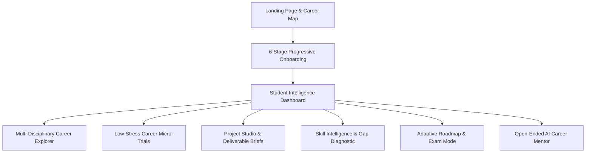

# Aaroh — Personal Career Intelligence Platform

> **"Know yourself. Explore your paths. Prove your potential."**  
> *Simple on the surface. Powerful underneath.*

Aaroh is a student-first personal career intelligence platform designed to move students from career ambiguity to verified proof-of-work. Moving beyond generic advice and uninspected claims, Aaroh helps students discover realistic multi-disciplinary career hypotheses, evaluate day-to-day fit through interactive micro-trials, close capability gaps with practical project briefs, and build an auditable evidence portfolio.

---

## Architecture & Technology Stack

- **Framework:** [Next.js 15 (App Router)](https://nextjs.org/) with React 19 and static route prerendering
- **Language:** [TypeScript 5.7](https://www.typescriptlang.org/) in strict mode (`tsc --noEmit`)
- **Styling:** [Tailwind CSS 3.4](https://tailwindcss.com/) with Midnight Indigo (`#0B1020`), Electric Blue (`#6D8DFF`), and Soft Mint (`#5EEAD4`) design tokens
- **Icons:** [Lucide React](https://lucide.dev/)
- **Unit & Integration Testing:** [Vitest 2.1](https://vitest.dev/) (263 tests across 14 test suites)
- **Browser E2E Testing:** [Playwright 1.64](https://playwright.dev/) across multi-browser engines (Chromium, Firefox, WebKit; 52 automated assertions per browser across 8 user journeys)
- **AI & Career Reasoning Engine:** Grounded local-first semantic reasoning engine (`ai-knowledge.ts`) with optional cloud LLM adapters (Gemini 1.5 Flash / OpenAI GPT-4o-mini), explicit user consent enforcement, and offline-only toggle
- **State Management & Data Portability:** Local-first reactive store with Web Crypto AES-256-GCM password-encrypted backups, safe JSON snapshot export/restore, interactive preview modal, trust clamping, and non-erasure evidence guarantees
- **Security & Abuse Protections:** Next.js HTTP security headers (CSP, HSTS, X-Frame-Options, X-Content-Type-Options), server-side IP rate limiting (20 req/min), origin validation, and sanitized API error handling

---

## Core Pillars & Functional Modules



1. **Multi-Disciplinary Career Exploration (`/explore`):**
   - 7 platform disciplines: Engineering, Commerce & Finance, Design, Public Policy, Environmental Data, Healthcare Coordination, and Tech Journalism.
   - Side-by-side 2–3 career comparison with transparent alignment factors.
2. **Career Micro-Trials (`/trials`):**
   - Realistic workplace scenario simulations evaluated against deterministic rubrics.
   - Decouples task performance from personal enjoyment affinity to guide discovery without pass/fail anxiety.
3. **Project Studio (`/projects`):**
   - Vertical-slice project briefs with milestones, testing checklists, and README template generation.
   - Evaluates deliverable attestations and architectural reflections against brief rubrics.
4. **Trusted Peer & Mentor Review System (`/projects` Review Hub):**
   - Portable, exportable JSON review packets (`AarohReviewPacket`) bound to submissions via deterministic 256-bit SHA-256 change-detection integrity fingerprints.
   - Anti-tampering validation, stale-review invalidation, active-review overwrite protection, and scoped skill reversion upon code changes.
   - Clear trust boundary: reviewer attribution is self-reported; advances skills to `practically_demonstrated` (`artifact_examined`) without claiming institutional PKI authority.
5. **Skill Intelligence (`/skills`):**
   - Distinguishes unassessed ground from demonstrated ability across an honest 6-state taxonomy:
     1. `not_assessed` (Unexplored baseline)
     2. `self_reported` (Independent self-study)
     3. `coursework` (College syllabus or lab)
     4. `student_attested` (Submitted brief deliverables; external code uninspected)
     5. `practically_demonstrated` (Artifact examined against rubric by unauthenticated peer/mentor)
     6. `independently_verified` (Proctored institutional exam or accredited authority)
6. **Adaptive Roadmap (`/roadmap`):**
   - Milestone progression synchronized with trial completions, project submissions, and reviewer decisions.
   - 1-tap **College Exam Mode** throttles weekly capacity to prevent burnout without manipulative streaks.
7. **Open-Ended AI Career Mentor (`/mentor`):**
   - Indian career landscape grounding (realistic entry-level base take-home pay, Tier 2/3 transitions, prompt injection defenses).
   - Strict evidence boundaries: prevents conversational skill elevation or roadmap completion tampering.
   - Privacy transparency: defaults to local browser reasoning; discloses external transmission when cloud API keys are enabled.
8. **Student Data Portability, Encrypted Backups & Safe Restore (`/dashboard`):**
   - Single-click export of complete student progress either as **Password-Protected Encrypted Backups** (AES-256-GCM via browser Web Crypto API) or plain JSON.
   - Safe client-side restore pipeline: pre-flight schema validation, 2MB size limit, prototype pollution rejection, interactive preview modal, and decrypt-on-import before modifying local state.
   - Shared-device data protection: 1-click **Wipe Local Data** action to safely clear student data on shared college library computers.
   - Evidence integrity guarantees: clamps unverified institutional claims to honest unauthenticated levels, verifies SHA-256 fingerprints, marks modified submissions as stale, and enforces strict non-erasure protection over pre-existing verified credentials.

---

## Verification & Quality Gates

Aaroh enforces strict, reproducible quality gates across all releases (Node.js v20+):

```bash
# 1. Typecheck TypeScript in strict mode (0 errors)
npm run typecheck

# 2. Run ESLint 9 CLI with Next.js Core Web Vitals (0 warnings)
npm run lint

# 3. Run all Vitest suites (263 tests across 14 suites)
npm test

# 4. Or run partitioned test suites:
npm run test:unit       # 190 core domain, security & data portability unit tests
npm run test:benchmark  # 73 AI evaluation benchmark & API contract tests

# 5. Build optimized Next.js 15 production bundle (13 static prerendered pages + 1 dynamic API route)
npm run build

# 6. Run Playwright real-browser E2E automation across browser engines:
npm run test:e2e:chromium # 52 checks in Chromium
npm run test:e2e:firefox  # 52 checks in Firefox
npm run test:e2e:webkit   # 52 checks in WebKit
npm run test:e2e:all      # Full cross-browser matrix (156 assertions)

# 7. Audit production runtime dependency health (0 vulnerabilities)
npm run audit:prod
```

---

## Environment Configuration

Aaroh is architected to function completely **offline and local-first** out of the box with zero required environment variables.

To optionally connect live external LLM services for the AI Career Guide (`/mentor`), copy `.env.example` to `.env.local` and configure your API keys:

```bash
cp .env.example .env.local
```

| Variable | Required | Description |
| :--- | :--- | :--- |
| `GEMINI_API_KEY` | Optional | Google AI Gemini API key (Gemini 1.5 Flash). If absent, engine defaults to local semantic knowledge. |
| `OPENAI_API_KEY` | Optional | OpenAI API key (GPT-4o-mini). Used as fallback cloud provider if Gemini is unconfigured. |

---

## Directory Structure

```
Arroh/
├── docs/                        # Architecture, Phase Tracker, and Requirements
│   ├── ARCHITECTURE.md          # System architecture, layered diagram, and tokens
│   ├── PHASE_TRACKER.md         # Comprehensive phase tracking and change log
│   └── REQUIREMENTS.md          # Product specification and non-negotiables
├── scripts/                     # Operational and verification scripts
│   └── e2e-browser-test.mjs     # Playwright browser automation test suite (47 assertions)
├── src/
│   ├── app/                     # Next.js 15 App Router pages and layouts
│   │   ├── api/ai/chat/         # AI mentor route handler with cloud & local fallback
│   │   ├── dashboard/           # Student command center & next best action
│   │   ├── explore/             # Multi-disciplinary career catalog & comparator
│   │   ├── mentor/              # Open-ended grounded AI career guide
│   │   ├── onboarding/          # 6-stage progressive profile onboarding
│   │   ├── projects/            # Project Studio & Review Hub
│   │   ├── roadmap/             # Adaptive roadmap with College Exam Mode
│   │   ├── skills/              # Skill matrix & honest evidence provenance
│   │   ├── trials/              # Career trial simulations
│   │   ├── layout.tsx           # Root layout and theme hydration
│   │   └── page.tsx             # Public landing page with career map
│   ├── components/              # Reusable UI & Shell components
│   │   ├── shell/               # AppShell, Desktop Sidebar, Mobile Bottom Nav
│   │   └── ui/                  # Button, Card, Badge, Modal, Progress
│   ├── lib/                     # Core domain logic, catalogs, and engines
│   │   ├── ai-evaluation-dataset.ts # 64-case AI benchmark with held-out split
│   │   ├── ai-knowledge.ts      # Grounded career knowledge, tax math, & reasoning engine
│   │   ├── careers-data.ts      # Curated multidisciplinary career catalog
│   │   ├── project-evaluation.ts# Deterministic submission evaluation engine
│   │   ├── projects-data.ts     # Project briefs with milestone rubrics
│   │   ├── recommendation-engine.ts # Career hypothesis scoring engine
│   │   ├── review-system.ts     # SHA-256 fingerprinting & review packet system
│   │   ├── skills-data.ts       # Platform skill catalog
│   │   ├── store.ts             # Reactive local store, persistence & migration
│   │   ├── trials-data.ts       # Micro-trials with scenario rubrics
│   │   ├── types.ts             # TypeScript definitions and data interfaces
│   │   └── utils.ts             # Helpers, formatters, and URL sanitization
│   └── __tests__/               # Automated Vitest test suites (228 tests)
│       ├── phase-7-integrity-audit.test.ts  # Phase 7 trust & salary audit (12 tests)
│       ├── ai-evaluation-suite.test.ts      # AI benchmark & provider contracts (73 tests)
│       ├── ai-onboarding-rebrand.test.ts    # Rebrand & onboarding invariants (12 tests)
│       ├── adversarial-review-audit.test.ts # Phase 4B adversarial audit (23 tests)
│       ├── peer-review-integrity.test.ts    # Phase 4A review system (22 tests)
│       ├── end-to-end-journeys.test.ts      # Product invariants & error safety (11 tests)
│       ├── evidence-integrity-audit.test.ts # Verification boundaries (13 tests)
│       ├── project-evidence-pipeline.test.ts# Project brief & rubric pipeline (18 tests)
│       ├── recommendation-validation.test.ts# Career intelligence validation (12 tests)
│       ├── trials-integrity.test.ts         # Career micro-trial simulations (22 tests)
│       ├── recommendation-engine.test.ts    # Career hypothesis scoring (7 tests)
│       └── ux-simplification.test.ts        # UI invariants & navigation (3 tests)
├── .env.example                 # Optional environment template for external LLM keys
├── eslint.config.mjs            # ESLint 9 flat configuration with next/core-web-vitals
├── package.json                 # Project dependencies and script runner (v1.0.0)
├── tsconfig.json                # TypeScript compiler configuration
└── vitest.config.ts             # Vitest test runner configuration
```

---

## Phase 8A Release Gate Summary

- **Release Gate Decision:** `READY WITH DOCUMENTED LIMITATIONS`
- **Current Build:** v1.0.0 (Hardened after Phase 8A Dependency Security Triage & Release Pipeline Hardening)
- **Integrity Baseline:** Fully offline-capable, local-first architecture. 228/228 Vitest unit/integration tests passing across 12 suites (155 core domain unit tests + 73 AI evaluation benchmark tests); 47/47 Playwright Chromium assertions passing across 7 user journeys; 0 TypeScript errors; 0 ESLint warnings via direct ESLint 9 CLI; 13 static pages prerendered + 1 dynamic API route.
- **Dependency Security Triage:** Production runtime dependencies have **0 vulnerabilities** (`npm audit --omit=dev`). Overrode `next`'s nested PostCSS dependency to patched `postcss@8.5.31`. Remaining 15 vulnerabilities are in test/dev tooling (`braces <=3.0.3` unpatched in npm; `tinypool <=2.1.1` in vitest; `vite/esbuild` dev server advisories). Documented zero-exposure boundary in Aaroh's CLI-only build/test configuration.
- **Reproducible Pipeline:** Modernized to direct ESLint 9 CLI (`eslint .`), eliminated `next lint` deprecation, partitioned tests (`test:unit`, `test:benchmark`, `test:e2e`), added graceful connection probing in Playwright E2E suite, and confirmed zero secret leakage.
