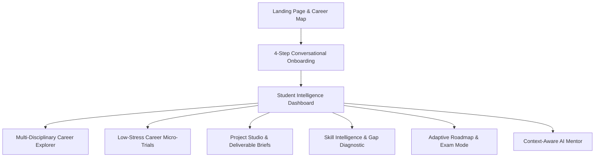

# Aaroh — Personal Career Intelligence Platform

> **"Know yourself. Explore your paths. Prove your potential."**  
> *Simple on the surface. Powerful underneath.*

Aaroh is a student-first personal career intelligence platform designed to move students from career ambiguity to verified proof-of-work. Moving beyond generic advice and uninspected claims, Aaroh helps students discover realistic multi-disciplinary career hypotheses, evaluate day-to-day fit through interactive micro-trials, close capability gaps with practical project briefs, and build an auditable evidence portfolio.

---

## Architecture & Technology Stack

- **Framework:** [Next.js 15 (App Router)](https://nextjs.org/) with React 19 and static route prerendering
- **Language:** [TypeScript 5.7](https://www.typescriptlang.org/) in strict mode (`tsc --noEmit`)
- **Styling:** [Tailwind CSS 3.4](https://tailwindcss.com/) with custom design tokens (`#101113` dark canvas, `#F59E0B` amber brand, `#34D399` emerald)
- **Icons:** [Lucide React](https://lucide.dev/)
- **Unit & Integration Testing:** [Vitest 2.1](https://vitest.dev/) (131 tests across 9 test suites)
- **Browser E2E Testing:** [Playwright 1.64](https://playwright.dev/) in headless Chromium (39 automated assertions across 6 user journeys)
- **State Management & Persistence:** Local-first reactive store with cross-page synchronization, storage normalization, and safe schema hydration

---

## Core Pillars & Functional Modules



1. **Multi-Disciplinary Career Exploration (`/explore`):**
   - 7 platform disciplines: Engineering, Commerce & Finance, Design, Public Policy, Environmental Data, Healthcare Coordination, and Tech Journalism.
   - Side-by-side 2–3 career comparison with transparent alignment factors.
2. **Career Micro-Trials (`/trials`):**
   - Realistic workplace scenario simulations evaluated against deterministic rubrics.
   - Decouples task performance from personal enjoyment affinity to guide discovery without pass/fail anxiety.
3. **Project Studio (`/projects`):**
   - Vertical-slice project briefs with milestones, testing checklists, and README template generation.
   - Evaluates deliverable attestations and architectural reflections against brief rubrics.
4. **Trusted Peer & Mentor Review System (`/projects` Review Hub):**
   - Portable, exportable JSON review packets (`AarohReviewPacket`) bound to submissions via deterministic 256-bit SHA-256 change-detection digests.
   - Anti-tampering validation, stale-review invalidation, active-review overwrite protection, and scoped skill reversion upon code changes.
5. **Skill Intelligence (`/skills`):**
   - Distinguishes unassessed ground from demonstrated ability across an honest 6-state taxonomy:
     1. `not_assessed` (Unexplored baseline)
     2. `self_reported` (Independent self-study)
     3. `coursework` (College syllabus or lab)
     4. `student_attested` (Submitted brief deliverables; external code uninspected)
     5. `practically_demonstrated` (Artifact examined against rubric by unauthenticated peer/mentor)
     6. `independently_verified` (Proctored institutional exam or accredited authority)
6. **Adaptive Roadmap (`/roadmap`):**
   - Milestone progression synchronized with trial completions, project submissions, and reviewer decisions.
   - 1-tap **College Exam Mode** throttles weekly capacity to prevent burnout without manipulative streaks.

---

## Verification & Quality Gates

Aaroh enforces strict quality gates across all releases:

```bash
# 1. Run unit and integration tests (131 tests across 9 suites)
npm test

# 2. Run TypeScript compiler type-checking (0 errors)
npm run typecheck

# 3. Run ESLint code quality & Core Web Vitals (0 warnings)
npm run lint

# 4. Build optimized Next.js 15 production bundle (12 static routes)
npm run build

# 5. Run Playwright real-browser E2E automation (39 checks in Chromium)
npm run test:e2e
```

---

## Directory Structure

```
Arroh/
├── docs/                        # Architecture, Phase Tracker, and Requirements
│   ├── ARCHITECTURE.md          # System architecture, layered diagram, and tokens
│   ├── PHASE_TRACKER.md         # Comprehensive phase tracking and change log
│   └── REQUIREMENTS.md          # Product specification and non-negotiables
├── scripts/                     # Operational and verification scripts
│   └── e2e-browser-test.mjs     # Playwright browser automation test suite
├── src/
│   ├── app/                     # Next.js 15 App Router pages and layouts
│   │   ├── dashboard/           # Student command center & next best action
│   │   ├── explore/             # Multi-disciplinary career catalog & comparator
│   │   ├── mentor/              # Context-aware AI career mentor
│   │   ├── onboarding/          # 4-step progressive profile onboarding
│   │   ├── projects/            # Project Studio & Review Hub
│   │   ├── roadmap/             # Adaptive roadmap with College Exam Mode
│   │   ├── skills/              # Skill matrix & evidence provenance
│   │   ├── trials/              # Career trial simulations
│   │   ├── layout.tsx           # Root layout and theme hydration
│   │   └── page.tsx             # Public landing page with career map
│   ├── components/              # Reusable UI & Shell components
│   │   ├── shell/               # AppShell, Desktop Sidebar, Mobile Bottom Nav
│   │   └── ui/                  # Button, Card, Badge, Modal, Progress
│   ├── lib/                     # Core domain logic, catalogs, and engines
│   │   ├── careers-data.ts      # Curated multidisciplinary career catalog
│   │   ├── project-evaluation.ts# Deterministic submission evaluation engine
│   │   ├── projects-data.ts     # Project briefs with milestone rubrics
│   │   ├── recommendation-engine.ts # Career hypothesis scoring engine
│   │   ├── review-system.ts     # SHA-256 fingerprinting & review packet system
│   │   ├── skills-data.ts       # Platform skill catalog
│   │   ├── store.ts             # Reactive local store, persistence & migration
│   │   ├── trials-data.ts       # Micro-trials with scenario rubrics
│   │   ├── types.ts             # TypeScript definitions and data interfaces
│   │   └── utils.ts             # Helpers, formatters, and URL sanitization
│   └── __tests__/               # Automated Vitest test suites (131 tests)
│       ├── adversarial-review-audit.test.ts # Phase 4B adversarial audit (23 tests)
│       ├── peer-review-integrity.test.ts    # Phase 4A review system (22 tests)
│       ├── end-to-end-journeys.test.ts      # Phase 3C product invariants (11 tests)
│       ├── evidence-integrity-audit.test.ts # Phase 3B verification boundaries (13 tests)
│       ├── project-evidence-pipeline.test.ts# Phase 3A project pipeline (18 tests)
│       ├── recommendation-validation.test.ts# Phase 2B career intelligence (12 tests)
│       ├── trials-integrity.test.ts         # Phase 2A trial simulation (22 tests)
│       ├── recommendation-engine.test.ts    # Hypothesis scoring (7 tests)
│       └── ux-simplification.test.ts        # UI invariants (3 tests)
├── package.json                 # Project dependencies and script runner
├── tsconfig.json                # TypeScript compiler configuration
└── vitest.config.ts             # Vitest test runner configuration
```

---

## Phase 4B Checkpoint Summary

- **Phase Status:** Phase 4B: Adversarial Trust & Evidence Integrity Audit (COMPLETED)
- **Current Build:** v0.4.1
- **Integrity Baseline:** Standard SHA-256 canonical submission binding, active review overwrite defense, scoped skill reversion upon code changes, XSS neutralization via URL sanitization, and strictly honest trust disclosures.
