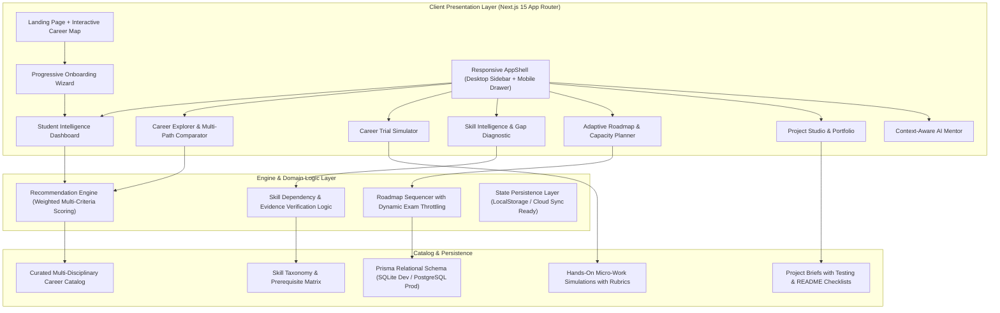

# Aaroh — System Architecture & Technical Specifications

## 1. Overview & System Purpose
Aaroh is an intelligent, student-first personal career intelligence platform designed to move students from career ambiguity to verified proof-of-work.

### Non-Negotiable Operational Tenets
1. **Never claim 100% deterministic certainty:** Career exploration recommendations are starting hypotheses, not psychic destinies.
2. **Transparent Skill Metrics:** Skill coverage scores represent verifiable rubric coverage, never "probabilities of getting hired".
3. **Multi-Disciplinary Equality:** First-class support for Engineering, Commerce, Arts/Design, Sciences, Healthcare, Law, and Media.
4. **Anti-Burnout & Exam Mode:** Dynamic throttling of roadmap capacity during college exams without manipulative streaks or guilt messaging.

---

## 2. Layered Architecture

---

## 3. Design System & Tokens
- **Dark Theme Canvas:** `#101113`
- **Secondary Surface:** `#15171A`
- **Cards:** `#1B1E22`
- **Interactive Surfaces:** `#22262B`
- **Borders:** `rgba(255, 255, 255, 0.08)` (subtle), `rgba(255, 255, 255, 0.16)` (medium)
- **Primary Brand Amber:** `#F59E0B` (glow: `rgba(245, 158, 11, 0.15)`)
- **Positive Emerald:** `#34D399`
- **Warning/Error Rose:** `#F43F5E`
- **Text:** Primary `#F8F9FA`, Muted `#9CA3AF`
- **Light Theme Equivalents:** High-contrast `#F8F9FA` canvas with `#FFFFFF` cards, `#DEE2E6` borders, and `#181A1D` text.
- **Typography:** Manrope for bold headings, Inter for high legibility body copy.
